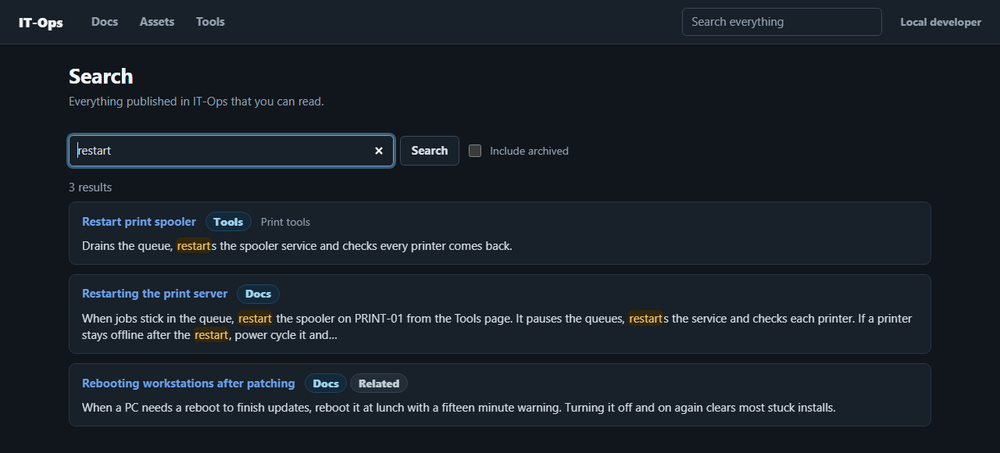
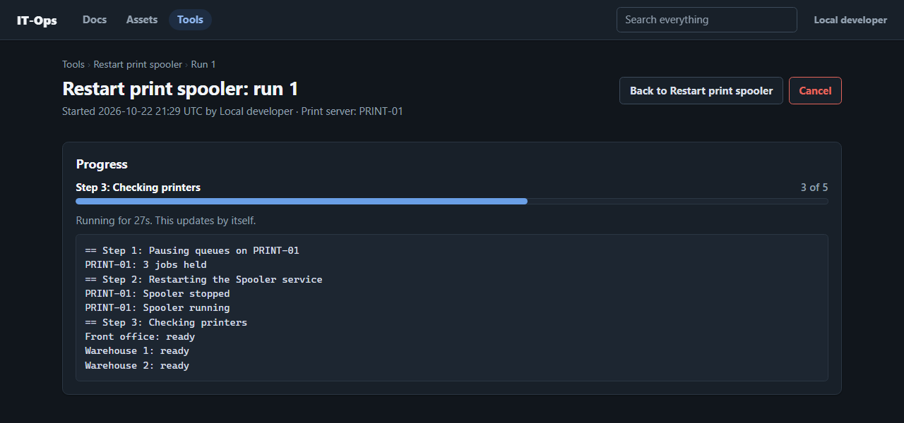

# IT-Ops platform

A small, modular platform for building internal IT applications. AI clients are
ordinary users of it, with the same permissions and the same audit trail as people.




I built it to replace a paid documentation product (ITGlue) and the pile of one-off
scripts that grew up around it at a mid-size manufacturer. The core handles the things
every internal app needs once. Modules add the actual applications and get all of it
without writing any of it.

## What the core gives a module

- Sign-in and permissions. Entra ID in production, a dev mode locally. Permissions are
  declared in the module's manifest. Some are marked `human_only`, which means an AI
  client can never hold them no matter what it's connected as.
- Audit trail. Every write records who did it: a person, a connector, or a person acting
  through AI. Nothing is deleted in place. Publish, retire and archive are the verbs.
- Search. One index across every module, keyword plus meaning. Keyword uses SQL Server
  full-text. Meaning uses a small embedding model run in-process (ONNX via fastembed)
  stored in a native `VECTOR` column. Results are fused, filtered to what the searcher
  may read, and typo-corrected against the index's own vocabulary. Nothing leaves the
  network and there is no per-query cost. Without the model, search is keyword-only
  and everything still works.
- Record types. Admin-defined types with typed fields. People or AI draft them, people
  approve them. A type can be retired without losing the records under it.
- Connectors. Every flow of data in or out. A connector runs on a schedule or on demand,
  acts as itself in the audit trail, supports dry runs, and remembers where each record
  came from so a re-run updates instead of duplicating.
- Tool actions. Fixed operations people run from one Tools page, with visible progress
  and one-at-a-time locking. Actions reach other servers only through constrained
  PowerShell endpoints (JEA). AI may request a run. A person approves it.
- MCP endpoint with OAuth. Every module's tools behind one `/mcp`. Users connect their
  own AI client (Claude, or anything that speaks MCP). Each call runs as that user via
  AI, so human-only permissions are refused and tools that change data produce drafts
  for review.
- Files, forms, theming, and a design page (`/_design`) so modules look identical
  without shipping their own CSS or JS.

## Modules in this repo

- docs: section-based IT documentation with drafts, publishing and immutable version
  history. It is not a password store. Credentials are referenced, not kept.
- assets: IT inventory (devices, certificates, contacts, locations, domains, IPs) with
  admin-defined types.

Each works without the other. When both are installed they link both ways.

## Try it

```
uv sync --all-packages      # install core + modules
uv run itops serve          # http://localhost:8800   (/_design shows the components)
uv run itops new module x   # scaffold a module that follows the rules
uv run pytest -q            # SQL Server needed for the database tests
```

Copy `.env.example` to `.env`. Dev mode needs a local SQL Server (Developer Edition
is fine) and nothing else.

## How it's built

Python 3.12, FastAPI, SQLAlchemy async against SQL Server, htmx and Alpine on the
front end, `uv` workspaces (core plus one package per module), ruff and pyright strict,
pytest with an in-process test app. Every module ships an `AGENTS.md` describing its
contract so an AI coding agent can work in it without being told the rules twice.

Most of the code was written with Claude Code. I did the design and the review. The
architecture decisions are ADRs in the internal repo, and the docstrings reference them
by number and carry the reasoning.

## Scope

This is an export of the generic part of a larger internal repository. Company-specific
modules, connectors, configuration and deployment are left out. It runs and the tests
pass. Treat it as a reference and a starting point, not a supported product.

Exported 2026-10-09 from `346fa68`.
